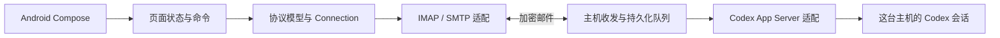

# 交互与架构

## 参考项目与取舍

- [CC Pocket](https://github.com/K9i-0/ccpocket) 的实机界面把任务状态放在会话附近，聊天正文与审批或工具活动有明确层级。AgentPost 保留聊天优先的内容布局、低干扰的任务状态以及一键复制代码。邮件版先把「发送」「主机接收」「完成」三个阶段做清楚。
- [Happy](https://happy.engineering/mobile-app/) 将主机配对放在第一次连接。AgentPost 用主机名称、邮箱和设备密钥配对，成功后记住配置，并在会话列表与聊天顶部持续显示目标主机。
- [RikkaHub](https://rikka-ai.com/) 将长回复、代码和输入框各自留出空间。AgentPost 保持输入框在底部，回复使用整行排版，代码可横向浏览与单独复制。

## 页面与状态

首次连接时先验证 QQ 邮箱，再拉取目标主机的第一页会话。未连接时可以进入演示，用同一套界面体验收到回执、等待回复和继续对话。错误状态保留表单和当前内容。

会话列表只反映已配对的主机。应用优先显示手机上加密保存的列表和历史，并标记「本机缓存」。用户可手动刷新，首次打开没有缓存的会话时会自动拉取历史，也可按需加载较早的消息。缓存以邮箱、主机邮箱和配对密钥标识为范围，断开后清除。会话草稿在本次应用运行期间按会话保留。新建会话在首条消息提交时发生。

发送后立即显示用户消息。服务通过已验证的邮件回执确认接收，界面随后等待结果。超时或主动暂停后，可以继续查询同一请求，或者结束等待并刷新会话。手机和桌面同时使用时，桥接服务会检查会话是否已有活跃任务。软件退出或链路中断可能留下结果未知的请求，此时应先查看主机已有历史。

## 模块边界

`client-core` 不依赖 Android，描述会话、分页和请求结果，并定义提交与等待接口。Android 管理输入、滚动、搜索和凭据存储。演示连接与真实邮件连接实现同一接口。

主机桥接负责验证邮件、请求去重与结果发件，并通过 Unix socket 调用目标机器的 Codex App Server。主机邮箱凭据和 Codex 凭据保留在主机侧，手机仅存自己的邮箱凭据和设备配对密钥。桥接对移动端发起的任务使用工作区沙盒，不自动批准超出权限的操作。上架其他平台只需实现文档定义的协议和本地安全存储。若以后加入实时传输，可复用同样的会话模型与界面状态，并按通道能力开放实时进度。
